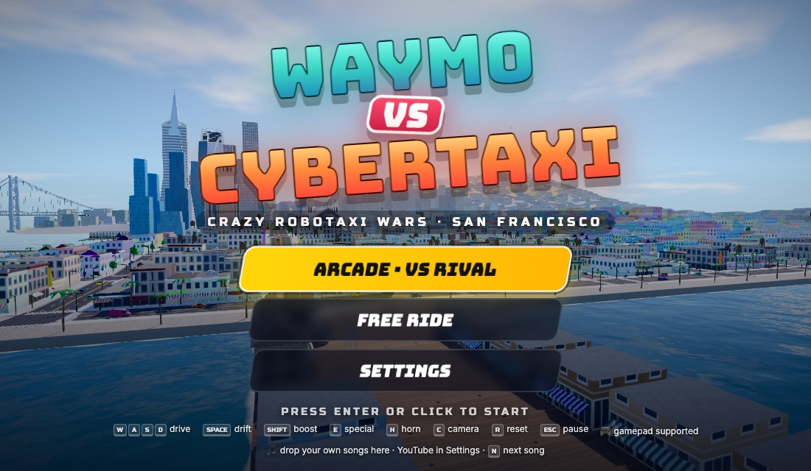
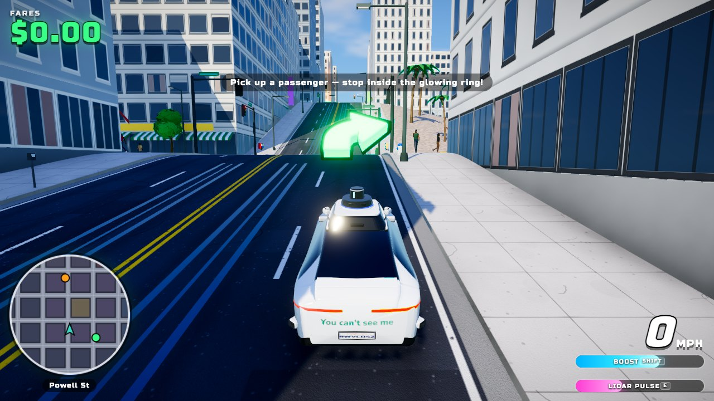
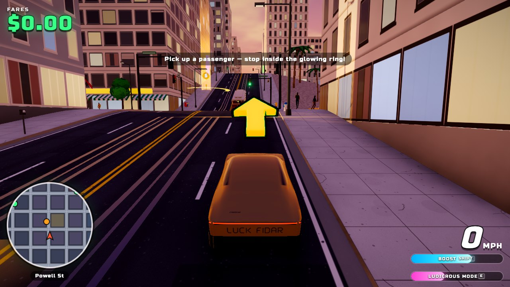
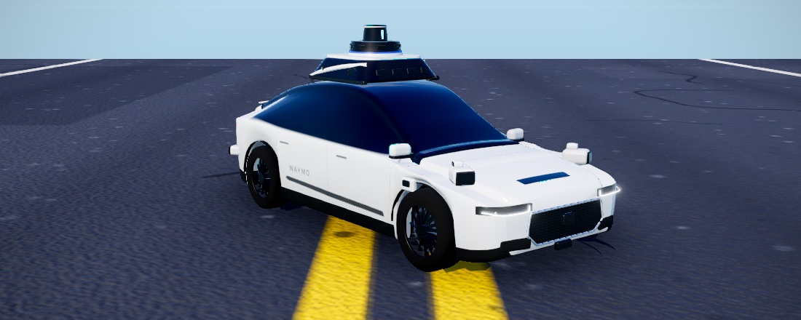
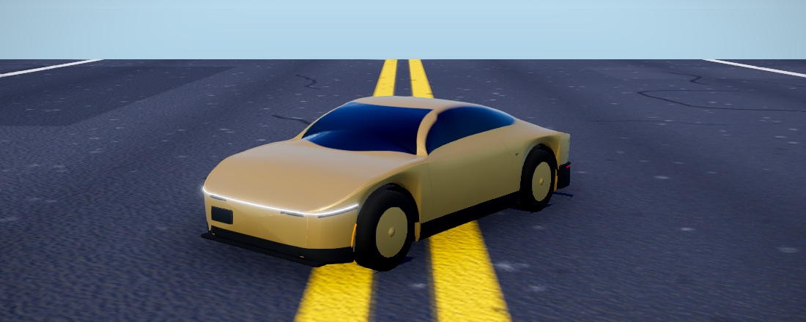

# WAYMO vs CYBERTAXI

A Crazy Taxi–style arcade game set in the hills of San Francisco. Choose a **Waymo**
(Jaguar I-PACE with the 5th-gen sensor dome) or a **Tesla Cybercab**. Pick up passengers,
race them across town, and out-earn the rival robotaxi before the clock runs out.

Everything is procedural: the city, the cars, the people, the landmarks, the textures,
the sound effects and the music. There are no asset files (the images below are only
for this page).



| Waymo on Powell St | Cybercab at sunset |
| --- | --- |
|  |  |

## Run it

```bash
npm install
npm run dev
```

Then open http://localhost:5178. For a production build: `npm run build && npm run preview`.
Node 20.19+ or 22.12+ is required (Vite 8).

Optional URL parameters:

- `?quick=waymo` or `?quick=cybercab`: skip the menus and start a race
- `&mode=free`: free ride (no clock, no rival)
- `&tod=day|sunset|night`: time of day

## Deploy to Netlify

[](https://app.netlify.com/start/deploy?repository=https://github.com/elatd/waymovscyber)

Or in Netlify: **Add new site → Import an existing project → GitHub**, then pick this
repository. `netlify.toml` already has everything Netlify needs, so there's nothing to
configure:

| Setting | Value |
| --- | --- |
| Build command | `npm run build` |
| Publish directory | `dist` |
| Node version | 22 |

It's a static site: no environment variables, functions or redirects. Every push to
`main` redeploys.

### Single-file build

`npm run build:single` writes the whole game (code, styles, audio, landmarks) into one
self-contained file, `artifact/waymo-vs-cybertaxi.html` (about 1.5 MB). It only needs
Google Fonts from the network. YouTube music doesn't work when that file is opened
straight from disk (YouTube only plays inside a website).

## Controls

| Action | Keyboard | Gamepad |
| --- | --- | --- |
| Drive / brake / reverse | W / S or ↑ / ↓ | RT / LT |
| Steer | A / D or ← / → | Left stick |
| Drift (handbrake) | Space | X or RB |
| Boost | Shift | B or LB |
| Special ability | E | Y |
| Horn | H | Stick click |
| Camera (chase / far / hood) | C | — |
| Look back | B | — |
| Reset car | R | — |
| Next song / next YouTube video | N | — |
| Pause | Esc / P | Start |

Touch controls appear automatically on phones and tablets.

## How to play (Crazy Taxi rules)

- Pick your robotaxi on the select screen. You can switch any time with **Change
  robotaxi** in the pause menu.
- Passengers wait on the sidewalks inside glowing rings. The ring color shows the trip
  length: red is short, orange is medium, yellow is long, green is epic.
- Stop inside the ring to pick them up. Then follow the big arrow and the minimap route
  to the green beam at the destination, and stop inside it. The arrow bends ahead of each
  upcoming turn, like a GPS.
- Getting there fast pays more and adds time to the clock: SPEEDY! +10 s, NORMAL +5 s,
  SLOW +2 s.
- Stunts with a passenger aboard earn tips that grow with your combo:
  - **Crazy Jump**: launch off the crest of a hill.
  - **Crazy Drift**: a sustained handbrake slide.
  - **Crazy Through**: a near miss with traffic.
- Streetlights, signal poles and trees topple when you hit them hard (or keep pushing),
  and you drive on through. They're back the next time you come around.
- A hard crash breaks your combo, and your passenger will let you know about it.
- **Arcade** mode: you start with 90 seconds on the clock. The AI rival robotaxi hunts the
  same fares and can steal the one you're heading for. Out-earn it before the clock runs
  out. Your best score for each car is saved in the browser.
- **Free Ride**: no clock and no rival. Just cruise and take fares.

### Specials (charge them with stunts and deliveries)

- **Waymo · LIDAR PULSE**: a lidar shockwave scans the city, shoves nearby traffic out
  of the way, and refills your boost.
- **Cybercab · LUDICROUS MODE**: a few seconds of rocket-sled acceleration and top
  speed. Traffic turns into bowling pins.

## Music

The game has its own synthesized punk-rock soundtrack. You can swap in your own:

- **Your songs**: drag audio files onto the game, or use **Settings → Add my music…**.
  They're kept in your browser for next time. **Settings → Soundtrack** switches between
  your songs and the game's, and **N** skips.
- **YouTube**: **Settings → YouTube music…**, then paste a video, playlist or channel
  (`youtube.com/channel/UC…`) link. It plays in a small picture-in-picture window you
  can drag out of the way (YouTube requires the player to stay visible). It replaces
  the game's soundtrack, and the sound effects keep playing. If a video can't be played
  outside youtube.com, the window says so and the game music comes back; playlists skip
  those videos. YouTube works on any website (like your Netlify site) and with
  `npm run dev`.

## San Francisco, compressed

The map is a stylized take on the northeast quadrant of the city. It includes Fisherman's
Wharf, Pier 39 (with sea lions), Hyde St Pier and the Balclutha, Ghirardelli Square, the
Palace of Fine Arts, Lombard Street's crooked block, Russian Hill, Nob Hill, Telegraph
Hill with Coit Tower, Washington Square and Saints Peter & Paul, Chinatown's Dragon Gate
and lantern-strung Grant Ave, Union Square, the Financial District with the Transamerica
Pyramid and Salesforce Tower, City Hall, the Painted Ladies at Alamo Square, the
Embarcadero and the Ferry Building.

Cable cars climb Powell St. In the distance you can see the Golden Gate Bridge (with Karl
the Fog), the Bay Bridge, Alcatraz, Angel Island, Marin, the East Bay and Sutro Tower.

Intersections are flat and the streets ramp steeply between them, the way SF's hills
really work. That geometry is what sends you flying off the crests.

## The cars

| Waymo (Jaguar I-PACE) | Tesla Cybercab |
| --- | --- |
|  |  |

Both are lofted from measured cross-sections of reference photos, with raycast-fitted
decals, lamps and trim. The Waymo carries the full sensor suite: roof lidar dome, side and
corner pods. Read the backs of the cars.

## Tech

- **Three.js** (WebGL2) with **postprocessing**: N8AO ambient occlusion, mipmap bloom,
  ACES tone mapping, color grading, SMAA, god rays, plus custom radial-blur and
  lidar-scan effects.
- One shared procedural facade shader draws windows, curtain walls, brick, storefronts
  and night lighting, so the whole city fits in a few dozen draw calls.
- Instanced traffic and street furniture. Breakable props fly when you hit them; poles
  and trees topple with simple rigid-rod physics.
- Pedestrians are procedural, rigged people (up to 17 bones each) with faces, hair,
  clothing, bags and phones, skinned in the vertex shader so a crowd is a handful of
  instanced draw calls.
- An arcade vehicle model with grip-limited cornering, power slides and real crest
  jumps, running on a fixed 120 Hz substep.
- All audio is synthesized with the Web Audio API: an electric-motor engine sound,
  tire screech, sound effects, and a procedural soundtrack. Your own songs play through
  the same mix and are stored in IndexedDB.
- Quality presets (Low to Ultra) and dynamic resolution scaling.
- Respects the OS reduced-motion setting: no camera shake, camera banking or speed lines.

## Project layout

```
src/
  core/        renderer + post FX, input, math
  world/       street layout & hills, roads, buildings, facade shader, sky, water,
               terrain, props, landmark placement, fog bank
  world/landmarks/  procedural SF landmark models
  vehicles/    car models, vehicle physics, traffic AI
  people/      rigged procedural humans, pedestrians & passengers
  game/        game flow, missions/fares, rival AI
  fx/          particles, skid marks, custom post effects
  ui/          HUD, minimap, menus, YouTube player
  audio/       synthesized engine/SFX/music, your-music storage
scripts/
  build-single.mjs     one-file build (npm run build:single)
  audio-smoke.mjs      Web Audio smoke test (node scripts/audio-smoke.mjs)
  check-landmarks.mjs  landmark geometry checks
viewer.html    dev-only model viewer: /viewer.html?car=waymo|cybercab, or ?people=walk|pose
```

## Disclaimer

A fan-made parody. Not affiliated with, endorsed by or sponsored by Waymo LLC or
Tesla, Inc. Waymo, Tesla and Cybercab are trademarks of their respective owners.
